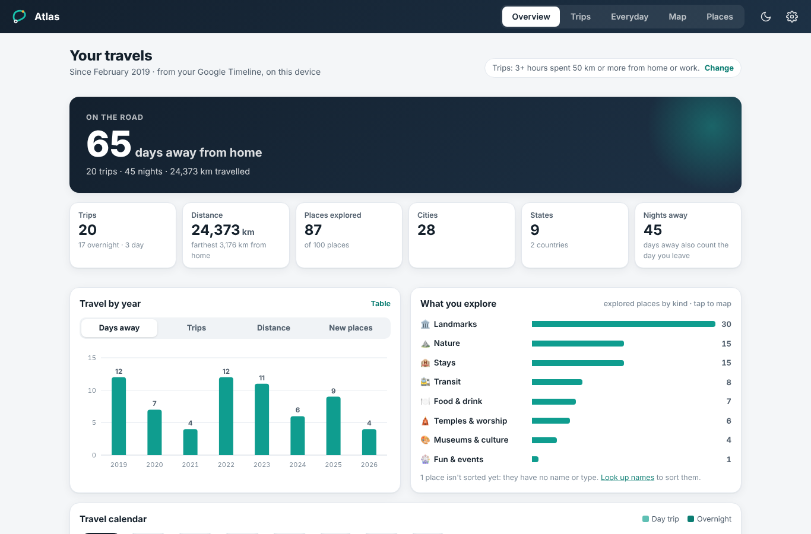
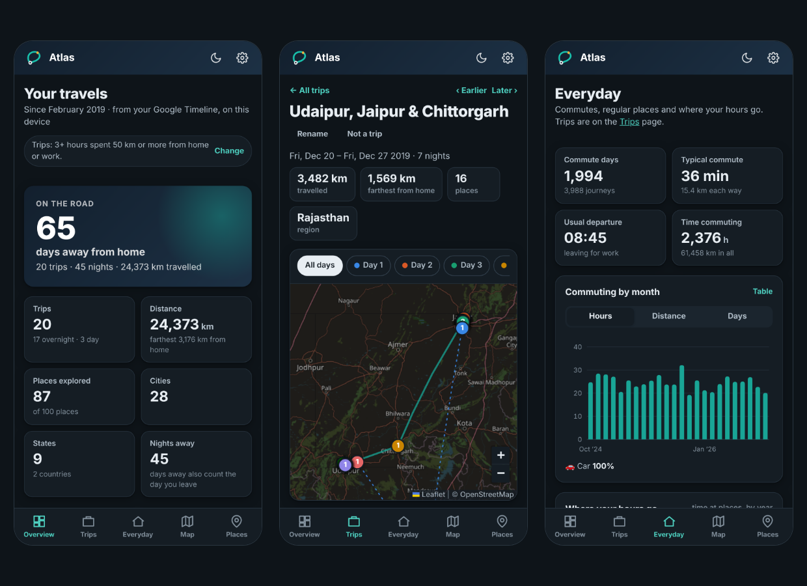
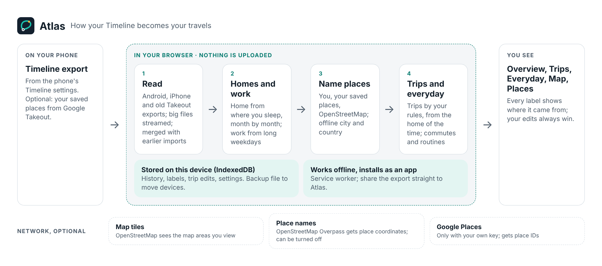
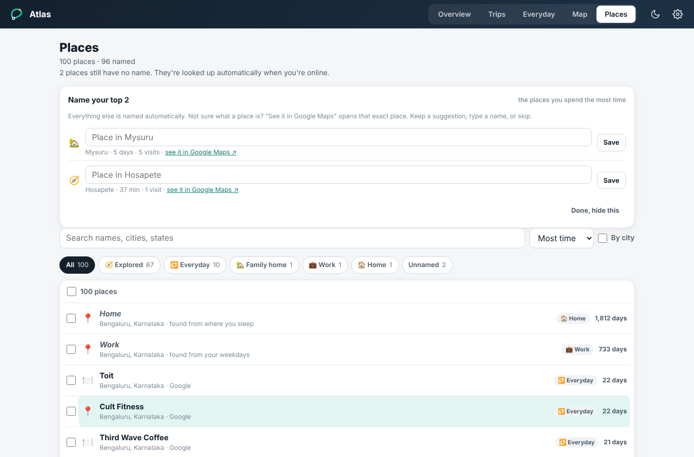

<p align="center"></p>

<h1 align="center">Atlas</h1>

<p align="center">
  <a href="https://github.com/khubli/atlas/actions/workflows/test.yml"></a>
  <a href="LICENSE"></a>
</p>

**Your travel history, rebuilt from your own Google Timeline, on your device.**

Export your Timeline from your phone, open Atlas and choose the file. Atlas finds every
trip you took, where you went and how you spend ordinary weeks. It all happens in your
browser: no account, no server, and your location history never leaves the device.

**[Open Atlas](https://atlas.khubli.in)** (tap *Try with demo data* to look around with
a made-up traveller) · **[Get your export](docs/setup.md)**, about 5 minutes



*Screenshots use the built-in demo traveller, not real data.*

## Why Atlas

Google moved Timeline onto the phone. What you can export is a large JSON file of
coordinates and place IDs: no names, no trips, nothing to browse. The usual answers are
to upload that file to someone's server, or to write scripts. Atlas does neither.

- **Nothing is uploaded.** The file is read by a worker inside your browser and stored
  there (IndexedDB). There's no server to trust, and none to pay for.
- **Trips are found for you.** Each has a day-by-day itinerary, a route map, distances
  and how you travelled. You set what counts as a trip (how far, how long, whether
  work or family homes count as home), and every screen updates at once.
- **Homes over time.** Home is found from where you actually slept, month by month, so
  moving city is a new home, not hundreds of "trips" back to the old one.
- **Everyday life, kept apart.** Commutes, regular places and where your hours go sit on
  their own page, so travel stats are about travel.
- **Names without an API bill.** The export has no names. Atlas uses the places you
  starred or labelled in Google Maps (your own Takeout data), then OpenStreetMap, which
  names a place only when something named is right at that spot. Everything else gets an
  honest label like "Near Hawa Mahal". A Google key is optional, not required.
- **Labels you can check.** Every place is home, work, family, everyday or explored,
  and shows where its name and kind came from. Your own edits always win and survive
  re-imports.
- **An app on your phone.** Installs as a PWA, works offline, and accepts the export
  straight from the phone's share menu.

**What it is not:** a live tracker or a sync service. It shows what your last export
contains, on the device you imported it on.
**Who it's for:** anyone with Google Timeline history who wants to look back at their
travels without handing that history to anyone.



## How it works

<picture>
  <source media="(prefers-color-scheme: dark)" srcset="docs/images/how-it-works-dark.png">
  
</picture>

Details, with a diagram of the code: [docs/how-it-works.md](docs/how-it-works.md).

## How you use it

1. **Export your Timeline** on your phone ([steps for Android and iPhone](docs/setup.md#1-export-your-timeline)).
2. **Open [atlas.khubli.in](https://atlas.khubli.in)** and choose the file. Install it
   from the browser menu if you like.
3. **Check what Atlas found:** your homes over time, work, family homes, and what counts
   as a trip. One tap fixes any of them.
4. **Optional, for better names:** import your Google Maps saved places
   ([how](docs/setup.md#3-better-place-names-optional)).

Import a newer export whenever you like; only new history is added. To move to another
device, Settings → Your data → **Back up**, then **Restore** there.



## Documentation

| | |
|---|---|
| [Setup](docs/setup.md) | Exporting from Android, iPhone or old Takeout; saved places; running your own copy |
| [Configuration](docs/configuration.md) | Trip rules, place kinds, naming sources, every setting and what Atlas stores |
| [How it works](docs/how-it-works.md) | The pipeline stage by stage, the code map, and privacy |
| [Brand](docs/brand/README.md) | Logo, palette, social preview |

## Commands

Requires Node 22.12+.

```bash
npm install
npm run dev          # http://localhost:5173, with the demo data
npm test             # unit tests (Vitest)
npm run test:e2e     # end-to-end tests (Playwright) against the production build
npm run build        # dist/: a static site for any static host
```

More in [CONTRIBUTING.md](CONTRIBUTING.md).

## Responsible use

Atlas is for your own history. Map tiles come from OpenStreetMap's servers and names
from the public Overpass API; both are shared community services, so Atlas asks in small
batches and keeps what it learns. If you run your own copy for many people, use your own
tile and Overpass servers (see [Configuration](docs/configuration.md#network)).

## Contributing

Issues and pull requests are welcome; see [CONTRIBUTING.md](CONTRIBUTING.md). To report a
security problem, see [SECURITY.md](SECURITY.md).

## How Atlas was built

Krishna Tej Hubli designed and directed Atlas: the problem, the requirements and
constraints (everything stays on the device, no server, works from the phone's own
export, labels reliable enough that filters work without manual fixing), the product and
architecture decisions, and the judgement calls tested against his own Timeline history
(what counts as a trip, how home and work are found, which names to trust). The code,
tests and docs were written by [Claude Code](https://claude.com/claude-code), Anthropic's
coding agent, working from that direction. He tried each round on his own data and
directed the fixes, and every commit credits Claude as co-author.

## License

[MIT](LICENSE) © 2026 Krishna Tej Hubli.

City data © [GeoNames](https://www.geonames.org) (CC BY 4.0). Map data ©
[OpenStreetMap](https://www.openstreetmap.org/copyright) contributors (ODbL). Maps by
[Leaflet](https://leafletjs.com) (BSD-2-Clause).
