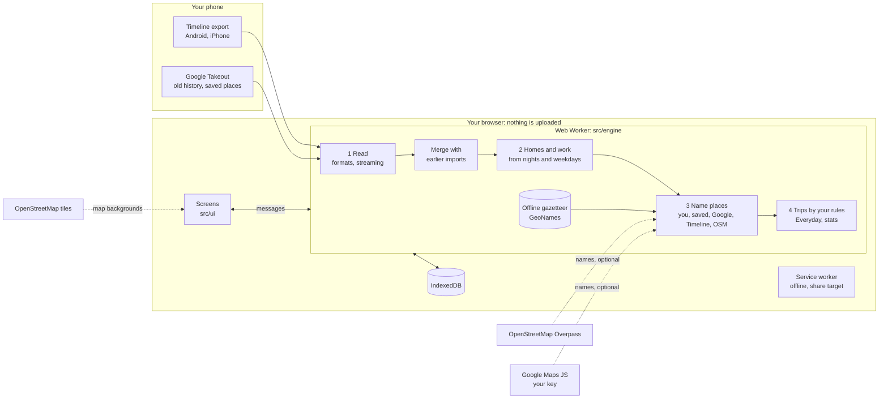

# How Atlas works

Atlas is a static web app. All the work happens in a Web Worker inside your browser,
and everything it keeps is stored in that browser's IndexedDB.

## 1. Read

`src/engine/formats/` recognises each export by its shape:

- **Android** (`semanticSegments`): visits, journeys and raw route points, with
  coordinates written as text (`"12.97°, 77.64°"`, sometimes with a double-encoded
  degree sign).
- **iPhone** (a bare array): `placeID`, `geo:` coordinates, numbers as strings,
  time-zone offsets in minutes.
- **Old Takeout** (`timelineObjects`): coordinates as E7 integers (with the sign fix for
  values that wrapped), monthly files or the whole zip.
- **Saved places** (GeoJSON from Takeout's *Maps (your places)*): names to use, not
  history.

Files over 24 MB are streamed, so a 100 MB export doesn't need 100 MB of text in memory.
`src/engine/ingest.js` merges each import with what is already stored and skips
duplicates, so importing a newer export or an old Takeout only adds what's new.

## 2. Homes and work

`src/engine/homes.js`. Home is where you sleep, not where Google's HOME label points
(that label can be years out of date).

1. A **night** is a stay of 3+ hours that crosses 3 a.m.
2. Each month, nights are grouped into areas about 1 km across, because the same home
   shows up under several place IDs hundreds of metres apart. The area with most nights
   holds home that month if it clearly dominates.
3. Consecutive months in the same area are one **home**; two or more months make it
   count. Homes change over time when you move, and each home starts at your first stay
   there after your last night at the previous one, so a move isn't a trip.
4. **Work** is a place, or places within 500 m, with 30+ weekdays of long daytime stays.

Your own labels decide whenever they say something.

## 3. Name places

`src/engine/places.js` layers labels; the first source with an answer wins: you, your
saved places, Google (with your key), Timeline, OpenStreetMap, then the visit pattern.
Every place keeps the source of its name and kind, and the screens show it.

- **OpenStreetMap** (`src/engine/osm.js`) asks Overpass about 20 places at a time for
  named things nearby, the neighbourhood and nearby landmarks. A name is taken only when
  it's right at the spot (shops ~30 m, places of worship and parks ~60 m, sights
  ~120 m); otherwise the place gets "Near *landmark*" or "*neighbourhood*, *city*".
- **City, state and country** come from an offline GeoNames gazetteer
  (`public/geo/places.json`), so they never need a lookup.
- **Tidying:** places within 100 m that can't be told apart are merged; single short
  stops nothing named are folded away as one-off stops.

## 4. Trips and everyday

`src/engine/trips.js` walks your visits in time order. A trip starts when you leave your
home base (home of the time, plus work and family homes if you choose) beyond the
distance you set, and ends when you're back. Short stops at home between two legs can
be joined, long gaps without data end a trip, and very long stays elsewhere count as
living there. Each trip gets an itinerary, a route, distances and travel modes.

`src/engine/everyday.js` finds home↔work commutes (short stops on the way are fine),
time at home, at work, at everyday places and exploring, and your regular places.

`src/engine/atlas.js` answers every screen's questions from these results. Changing a
trip rule or a label recomputes them at once.

## Code map

| Path | What |
|---|---|
| `src/engine/formats/` | Readers for Android, iPhone, Takeout, saved places, zip, streaming |
| `src/engine/ingest.js` | Merging imports, dedupe |
| `src/engine/homes.js` | Homes over time, work |
| `src/engine/places.js` | Labels, kinds, names, merging, one-off stops |
| `src/engine/classify.js` | Categories and themes from place types |
| `src/engine/geocode.js` | Offline city/state/country |
| `src/engine/osm.js` | OpenStreetMap names and labels |
| `src/engine/trips.js`, `everyday.js` | Trips by your rules; commutes and routines |
| `src/engine/atlas.js` | Queries for the screens |
| `src/worker/` | The Web Worker and its service: storage, import, backup, naming jobs |
| `src/store/db.js` | IndexedDB |
| `src/data/client.js` | The page's side of the worker messages |
| `src/ui/` | Screens (`views/`), charts, maps, rename, naming, PWA helpers |
| `src/sw.js` | Service worker: offline cache, map tile cache, share target |
| `src/demo/` | The fictional demo traveller |
| `scripts/` | Demo data, gazetteer, icons, docs images, screenshots, test fixtures |
| `tests/unit/`, `tests/e2e/` | Vitest and Playwright |

## Privacy

- **Your history never leaves the device.** There's no server and no account. The site
  is static files; the host sees only that someone loaded them.
- **Stored in this browser only** (IndexedDB). Deleting site data, or Settings → Your
  data → Delete everything, removes it.
- **What goes over the network:** map tiles for the areas you view (OpenStreetMap);
  coordinates of unnamed places to the Overpass API, which you can turn off; place IDs
  to Google, only if you add your own key. Nothing else.
- **Backups** are files you save yourself. They never include the Google key.
- **No analytics, no tracking, no cookies.**
